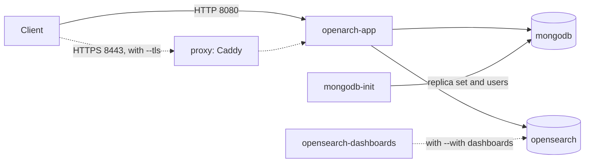

<p align="center">
  
  
</p>

<p align="center">
  Install and run <a href="https://github.com/hyland/OpenArch">Hyland OpenArch</a> with Docker Compose, from one command line tool.
</p>

<p align="center">
  <a href="https://github.com/AlfrescoLabs/openarch-cli/actions/workflows/ci.yml"></a>
  <a href="https://github.com/AlfrescoLabs/openarch-cli/releases/latest"></a>
  <a href="go.mod"></a>
  <a href="#verify-the-release"></a>
  <a href="LICENSE"></a>
</p>

<p align="center">
  
</p>

# CLI for OpenArch

> [!IMPORTANT]
> **Not an official Hyland product.** The CLI for OpenArch (the `openarch` command) is not Hyland OpenArch. It is in the [AlfrescoLabs](https://github.com/AlfrescoLabs) organization on GitHub because Hyland does not officially support it. Hyland OpenArch itself is at [github.com/hyland/OpenArch](https://github.com/hyland/OpenArch).

The CLI for OpenArch (`openarch`) is a command line tool to install and run [Hyland OpenArch](https://github.com/hyland/OpenArch) with Docker Compose.

It creates a workspace folder with plain files: `compose.yaml`, `.env`, `.env.local` and a few config files.
You can read them, and you can run `docker compose` on them without the CLI.

## Why the CLI for OpenArch

- **Plain files.** The workspace is a normal Docker Compose project. You can keep using it without the CLI.
- **For people and for scripts.** Every question in the interactive mode is also a flag.
- **For automation and AI agents.** Every command supports `--output json`, and the exit codes are stable.
- **Secure by default.** Generated passwords, Compose secrets and optional HTTPS. You can turn off each part.
- **After the install.** Status, logs, users, upgrades, backups, restores and password rotation.
- **Signed releases.** Checksums are signed with Sigstore, and `openarch self-update` checks the signature.

## Requirements

- Docker with Docker Compose v2 or later
- About 4 GB of memory for Docker
- Go 1.26 or later, only to build the CLI from source

On native Linux, OpenSearch needs `vm.max_map_count` set to at least 262144. `openarch doctor` checks this.

## Install

With Homebrew (macOS and Linux):

```
brew install AlfrescoLabs/tap/openarch
```

With Scoop (Windows):

```
scoop bucket add alfrescolabs https://github.com/AlfrescoLabs/scoop-bucket
scoop install openarch
```

Homebrew also installs the shell completions. Update with `brew upgrade openarch` or
`scoop update openarch`.

Archives, signature checks and builds from source are in [More install options](#more-install-options).

## Quick start

```
openarch doctor
openarch init --dir my-openarch
openarch up --dir my-openarch
```

For a tour of every feature in a temporary folder, see [docs/walkthrough.md](docs/walkthrough.md).

`up` returns when OpenArch is healthy. OpenArch is then at http://localhost:8080, and the Swagger UI
is at http://localhost:8080/swagger-ui/index.html. The first start pulls about 2 GB of images, so it
takes a few minutes.

The admin user is `admin`. Its password is in `my-openarch/.env.local`, as `OPENARCH_ADMIN_PASSWORD`.

## Commands

The current release is 0.6.0. The commands:

| Command | What it does |
| --- | --- |
| `openarch doctor` | Checks Docker, Docker Compose, memory, free ports and access to the image registry |
| `openarch init` | Creates a workspace with every deployment option |
| `openarch render` | Writes the workspace files again from `openarch.yaml` |
| `openarch up` | Starts the stack and waits until it is healthy |
| `openarch status` | Shows the state of each service and of the OpenArch API |
| `openarch logs` | Shows the logs of the services |
| `openarch down` | Stops the stack and keeps the data |
| `openarch api ping` | Checks that OpenArch answers and that the credentials work |
| `openarch config` | Saves connections to OpenArch servers (`set`, `get`, `list`, `use`, `delete`, `whoami`) |
| `openarch query` | Runs a query and lists the documents found |
| `openarch documents` | Gets, creates and lists documents, and uploads and downloads their files |
| `openarch users` | Manages the OpenArch users of a workspace (`list`, `add`, `set-password`, `delete`) |
| `openarch demo` | Adds sample users and documents that show permission-aware search (`users`, `load`, `reset`). See [Demo](#demo) |
| `openarch credentials` | Shows the users and passwords of a local workspace |
| `openarch smoke-test` | Checks OpenArch end to end: create, read, query and delete a document |
| `openarch upgrade` | Changes the OpenArch version, then checks the result |
| `openarch migrate` | Updates `openarch.yaml` to the schema of this release |
| `openarch backup`, `openarch restore` | Back up and restore MongoDB, the OpenArch files and the OpenSearch indices |
| `openarch clean` | Stops the stack and deletes its data |
| `openarch secrets rotate` | Gives new passwords to the OpenArch, MongoDB and OpenSearch users |
| `openarch mcp` | Runs an MCP server, so that AI agents can use the commands as tools |
| `openarch skill` | Installs the Agent Skill that teaches AI coding agents to use the CLI (`install`, `show`) |
| `openarch plugin list` | Lists the plugins (`openarch-<name>` executables) on `PATH`. See [Plugins](#plugins) |
| `openarch self-update` | Replaces the binary with the latest release, after a signature check |
| `openarch completion` | Prints the shell completion script for bash, zsh, fish or PowerShell |
| `openarch version` | Prints the version |

## More install options

### Manual install

Download the archive for your system from the
[releases page](https://github.com/AlfrescoLabs/openarch-cli/releases): Linux, macOS and Windows, on
amd64 or arm64. Each archive has the `openarch` binary, the license, this README and the walkthrough.

```
VERSION=0.5.2
OS=linux        # or darwin, windows
ARCH=amd64      # or arm64
curl -LO "https://github.com/AlfrescoLabs/openarch-cli/releases/download/v$VERSION/openarch_${VERSION}_${OS}_${ARCH}.tar.gz"
curl -LO "https://github.com/AlfrescoLabs/openarch-cli/releases/download/v$VERSION/checksums.txt"
sha256sum --ignore-missing -c checksums.txt     # on macOS: shasum -a 256 --ignore-missing -c checksums.txt
tar xzf "openarch_${VERSION}_${OS}_${ARCH}.tar.gz"
sudo mv openarch /usr/local/bin/
openarch version
```

On Windows, download the `.zip` archive and put `openarch.exe` in a folder on your `PATH`.

The binaries are not signed with an Apple or Microsoft certificate. When a browser downloaded the file,
macOS may block it: run `xattr -d com.apple.quarantine openarch` once. Windows may show a SmartScreen
warning.

### Verify the release

`checksums.txt` is signed with [cosign](https://docs.sigstore.dev/) by the release workflow of this
repository (keyless, with the GitHub Actions identity). Each archive also has an SBOM
(`.sbom.json`, SPDX format).

```
curl -LO "https://github.com/AlfrescoLabs/openarch-cli/releases/download/v$VERSION/checksums.txt.sigstore.json"
cosign verify-blob checksums.txt \
  --bundle checksums.txt.sigstore.json \
  --certificate-identity "https://github.com/AlfrescoLabs/openarch-cli/.github/workflows/release.yml@refs/tags/v$VERSION" \
  --certificate-oidc-issuer https://token.actions.githubusercontent.com
```

Release 0.1.0 has `checksums.txt.sig` and `checksums.txt.pem` instead of the bundle: use
`--certificate checksums.txt.pem --signature checksums.txt.sig` in place of `--bundle`.

### Update

`openarch self-update` replaces the binary with the latest release. It checks the same signature and
the SHA-256 of the archive first, so it needs no cosign. `openarch self-update --check` only reports if
a newer release exists. Installs by Homebrew or Scoop are updated with those tools instead.

### Build from source

```
git clone https://github.com/AlfrescoLabs/openarch-cli.git
cd openarch-cli
make build
./bin/openarch version
```

Without `make`: `go build -o bin/openarch ./cmd/openarch`.

### Shell completion

Completion knows the commands, the flag values, the services of the workspace (`openarch logs <Tab>`)
and the saved contexts (`--context <Tab>`, `openarch config use <Tab>`).

```
# zsh: add to ~/.zshrc (needs compinit)
source <(openarch completion zsh)

# bash: add to ~/.bashrc (needs the bash-completion package)
source <(openarch completion bash)

# fish
openarch completion fish > ~/.config/fish/completions/openarch.fish

# PowerShell: add to $PROFILE
openarch completion powershell | Out-String | Invoke-Expression
```

`openarch completion <shell> --help` shows more options.

## Create a workspace

Run `openarch init` in a terminal, and it asks for each option that you did not give as a flag.
At the end it prints the same command with flags, so you can repeat it or use it in a script.

With `--non-interactive`, or when there is no terminal, `init` never asks. It uses the defaults for
missing values.

| Option | Flag | Values | Default |
| --- | --- | --- | --- |
| OpenArch version | `--version` | image tag of `ghcr.io/hyland/openarch-app-jvm` | latest tested tag |
| Storage | `--storage` | `volume` (Docker named volumes), `bind` (folders on the host), `none` (data is lost when the containers are removed) | `volume` |
| Data folder | `--data-dir` | path, with `--storage bind` | `./data` |
| HTTPS | `--tls` | `none`, `self-signed` (the CLI creates a certificate), `custom` (your own files) | `none` |
| Certificate files | `--cert`, `--key` | PEM files, with `--tls custom` | - |
| Server name | `--server-name` | host name for URLs and the certificate | `localhost` |
| Port | `--port` | host port | 8080, or 8443 with TLS |
| Listen address | `--bind-ip` | `127.0.0.1` (this machine only) or `0.0.0.0` (all interfaces) | `127.0.0.1` |
| Extra ports | `--expose` | `mongodb` (27017), `opensearch` (9200), `debug` (Java debugger, 5005), repeatable | none |
| Extra services | `--with` | `dashboards` (OpenSearch Dashboards on port 5601), repeatable | none |
| Memory | `--memory` | `auto` (from `docker info`) or a size such as `8g` | `auto` |
| Backend security | `--insecure-backends` | turns off authentication in MongoDB and OpenSearch | secured |
| OpenArch users | `--default-users` | keeps the users bundled in the OpenArch image | only `admin` |
| Admin password | `--admin-password-stdin` | read from stdin | generated |

Other flags:

- `--dry-run` lists the files that `init` would write, and writes nothing.
- `--force` overwrites an existing workspace. It keeps the passwords in `.env.local`.
- `--from <file>` creates a workspace from an existing `openarch.yaml`.

Examples:

```
# Data in folders on the host
openarch init --dir my-openarch --storage bind --data-dir /srv/openarch

# HTTPS with a self-signed certificate, on https://openarch.local:8443
openarch init --dir my-openarch --tls self-signed --server-name openarch.local

# HTTPS with your own certificate, open to the network
openarch init --dir my-openarch --tls custom --cert server.pem --key server-key.pem \
  --server-name openarch.example.com --port 443 --bind-ip 0.0.0.0

# A machine for development: debugger, OpenSearch Dashboards, more memory
openarch init --dir my-openarch --expose debug --with dashboards --memory 8g

# Your own admin password
printf '%s' "$PASSWORD" | openarch init --dir my-openarch --admin-password-stdin --non-interactive

# Every security feature off: plain HTTP, no passwords for MongoDB and OpenSearch,
# and the bundled OpenArch users (admin:password)
openarch init --dir my-openarch --insecure-backends --default-users
```

Risky choices print a warning on stderr, for example `--bind-ip 0.0.0.0` without TLS.

## Change a workspace

`openarch.yaml` is the source of truth. To change the deployment:

1. Edit `openarch.yaml`.
2. Run `openarch render --dry-run` to see the diff.
3. Run `openarch render` to write the files.
4. Run `openarch up`. It recreates only the services whose files or passwords changed.

`render` only touches files that change. When an option no longer needs a file (for example, the proxy
config after you turn off TLS), `render` deletes it.

After an update of openarch, a workspace made by an older release still works. Commands print a
warning, and `openarch migrate` updates `openarch.yaml` to the new schema (`--dry-run` shows the
diff). If a newer openarch wrote the file, run `openarch self-update`.

## Run OpenArch

Run these in the workspace folder, or add `--dir my-openarch`:

```
openarch up                       # start, and wait until healthy
openarch status                   # state of each service and of the API
openarch logs openarch-app -f     # follow the OpenArch logs
openarch down                     # stop, and keep the data
```

- `up` runs the `doctor` checks first. Ports that this workspace already uses are not reported as busy.
  Use `--skip-doctor` to skip the checks.
- `up` waits up to 10 minutes. Change it with `--timeout`, or use `--wait=false` to return at once.
- `status` exits with code 0 when the stack is healthy, and 4 in any other state
  (`starting`, `unhealthy`, `stopped`).
- `down` keeps the named volumes and data folders. With `--storage none` there is no data to keep, so
  its volumes are removed.

### Without the CLI

The workspace is a plain Docker Compose project. In secure mode (the default), Docker Compose needs
both env files:

```
cd my-openarch
docker compose --env-file .env --env-file .env.local up -d
docker compose ps
docker compose logs -f openarch-app
docker compose down
```

With `--insecure-backends`, there are no secrets, and `docker compose up -d` is enough.

After a change to a password or to a file in `config/`, add `--force-recreate` to `up`. `openarch up`
does this for you, and only for the services that need it.

## Connect to the OpenArch API

Commands that call the API, such as `openarch api ping`, find the URL, user and password in this order:

1. Flags: `--url`, `--user`, `--password-stdin`. `--password` works too, but it prints a warning,
   because the password stays in the shell history.
2. Environment variables: `OPENARCH_URL`, `OPENARCH_USER`, `OPENARCH_PASSWORD`.
3. A saved connection (a context, see below) chosen with `--context` or `OPENARCH_CONTEXT`.
4. The workspace in `--dir` or in the current folder: the URL from `openarch.yaml`, and the admin user
   and password from `.env.local`.
5. The current context.
6. A hidden prompt, when the command runs in a terminal.

The first source that has a value wins, for each value. The user and password of a context or a
workspace are used only with its own URL, so they are never sent to another server.
`openarch config whoami` shows which source gave each value. It never shows the password.

```
openarch api ping                                  # inside a workspace: no flags needed
openarch api ping --dir my-openarch --output json
printf '%s' "$PASSWORD" | openarch api ping --url https://openarch.example.com --user admin --password-stdin
```

- With a self-signed workspace certificate, the CLI trusts the workspace certificate. It also connects
  to the published port on this machine, so the server name does not need to resolve.
- `--insecure` (or `OPENARCH_INSECURE=true`) turns off certificate checks, with a warning each time.
- `--verbose` logs each request, with the `Authorization` header replaced by `REDACTED`.
- Exit code 6 means the credentials are missing or wrong, or the user has no permission
  (HTTP 403). Exit code 5 means the server cannot be reached or returned an error.

## Documents and queries

```
openarch query "SELECT * FROM SysFolder"
openarch query "SELECT * FROM SysContent" --limit 50 --sort sys_title --output json
openarch documents get /                                   # by path: the value starts with /
openarch documents get dae8e1bb-ef08-44e5-81ae-451d785a3643  # by id
openarch documents create --parent / --type SysFolder --name projects --title Projects
openarch documents create --parent /projects --file report.json
openarch documents list /projects
openarch documents upload report.pdf --parent /projects
openarch documents content /projects/report.pdf --out report.pdf
```

- Queries use HxQL, a SQL-like language, by default. `--syntax expr` selects the expression syntax.
- New documents reach the search index after a short delay. `--sync` makes the query wait for it.
- Full-text queries (`WHERE sys_fulltext = 'word'`) work only on the search index, so do not use `--sync`
  with them. They find words in the name, title and description, not inside uploaded files: OpenArch
  stores files but does not extract their text.
- `documents content` checks the SHA-256 of the download against the digest that OpenArch stored.
- With `--output json`, documents and query results are the server responses as they are.

## Smoke test

`openarch smoke-test` creates a folder under the root, reads it by id and by path, finds it with a
query and in the background search index, deletes it, and checks that it is gone. It reports each
step, and deletes the folder even when a step fails.

```
openarch smoke-test
openarch smoke-test --context prod --output json
```

Exit code 0 means every step passed. Exit code 4 means a step failed, and 6 means the credentials were
rejected. `--index-timeout` (default 60s) sets how long to wait for the search index.

## Upgrades, backups and clean

```
openarch upgrade --version 1.0.93 --dry-run     # show the plan
openarch upgrade --version 1.0.93               # pull, render, start, smoke test
openarch backup                                 # into backups/<time> in the workspace
openarch restore backups/20261103T120415Z       # replaces all the data
openarch clean                                  # deletes all the data
```

- `upgrade` pulls the new image first, so a version that does not exist changes nothing. Then it writes
  the version into `openarch.yaml`, starts the stack, waits until it is healthy, and runs the smoke
  test. There is no automatic rollback: make a backup first.
- `backup` writes `mongodb.archive.gz` (a `mongodump`), `files.tar.gz` (the OpenArch files),
  `opensearch.tar.gz` (an OpenSearch snapshot of the OpenArch indices) and `manifest.json` (the
  version, and a SHA-256 for each file). The backup folder and its files are private (mode 0700 and
  0600), and `backups/` is git-ignored. The backup runs while OpenArch runs: changes made during the
  backup may be missing from it.
- `restore` checks every file of the backup first. Then it stops OpenArch, restores the three parts,
  starts the stack and waits until it is healthy. It works on a running stack and after `clean`.
- `clean` deletes the containers and volumes. With `--storage bind`, the data folders are kept.
- `restore` and `clean` ask for confirmation, and need `--yes` without a terminal.
- The passwords of MongoDB and OpenSearch never leave the containers: the backup commands read them
  from the container secrets.

## Users

OpenArch has no API to manage users. It reads them from `config/users.yml` when it starts. The
`users` commands change that file, and `openarch up` restarts OpenArch to apply the change.

```
openarch users list
openarch users add alice --email alice@example.com          # asks for the password
openarch users add bob --admin --password-stdin < bob.txt
openarch users set-password alice
openarch users delete alice
openarch up                                                 # apply the changes
```

- Passwords are stored as bcrypt hashes. The passwords of added users are not stored anywhere else.
- `users set-password admin` also changes `OPENARCH_ADMIN_PASSWORD` in `.env.local`, so the CLI keeps
  working.
- `openarch render` keeps every user and group in the file.
- These commands work on a workspace only, and not with `--default-users`.

## Demo

OpenArch answers queries with the documents that the caller may read. `openarch demo` shows it with
two users and a few documents: the same query returns different documents for each user.

```
openarch init --dir my-openarch
openarch demo users --dir my-openarch      # alice (group demo-hr) and bob (group demo-finance)
openarch up --dir my-openarch
openarch demo load --dir my-openarch       # folders and documents under /Demo
openarch query "SELECT * FROM SysFile WHERE sys_path STARTSWITH '/Demo/'" --context local
openarch query "SELECT * FROM SysFile WHERE sys_path STARTSWITH '/Demo/'" --context local-alice
openarch query "SELECT * FROM SysFile WHERE sys_path STARTSWITH '/Demo/'" --context local-bob
```

| Folder | Who can read it | Documents |
| --- | --- | --- |
| `/Demo/Public` | every user (group `members`) | Holiday calendar 2026, Office Wi-Fi guide |
| `/Demo/HR` | group `demo-hr` (alice) | Salary bands 2026, Hiring plan Q1 2027 |
| `/Demo/Finance` | group `demo-finance` (bob) | Budget forecast 2027 |
| `/Demo/Board` | administrators only | Merger proposal |

The admin sees 6 documents, alice 4 and bob 3. A query on titles shows it too:
`"SELECT * FROM SysFile WHERE sys_title LIKE '%2027%'"` gives alice the hiring plan and bob the budget.

- `demo users` generates the passwords, and saves the contexts `<prefix>-alice` and `<prefix>-bob`. The
  prefix is the name of the workspace context (`--context-name` of `init`, default `local`).
  OpenArch reads its users only at startup, so run `openarch up` after it.
- `demo load` works as the workspace admin. When `/Demo` exists it loads nothing; `--force` deletes it
  first. `demo reset` deletes `/Demo`. The users stay.
- The documents have metadata only (title and description): OpenArch does not extract text from files.
- `openarch credentials` shows the admin and the demo users with their passwords, in clear text.
- Demo users work on a workspace only, and not with `--default-users`.

## Saved connections

A context is a saved connection: a local workspace, or the URL and user of a remote OpenArch.

```
openarch config set --name prod -s https://openarch.example.com -u admin   # asks for the password
openarch config list
openarch config use prod
openarch api ping                                  # uses the current context
openarch api ping --context local                  # or any context, from any folder
openarch config get --name prod                    # the password is masked
openarch config delete prod                        # also removes the stored password
```

- `openarch init` saves each workspace as a context: `local` for the first one, then the workspace
  name. Use `--context-name` to choose the name.
- `config set` checks the connection before it saves it. `--no-verify` skips the check. The password
  comes from a hidden prompt or `--password-stdin`, never from a command argument.
- Contexts are in `config.yaml`, in `~/.config/openarch` (or `$XDG_CONFIG_HOME/openarch`, or
  `%AppData%\openarch` on Windows, or `OPENARCH_CONFIG_DIR`). That file never holds a password.
- Passwords are in the OS credential store: Keychain on macOS, Credential Manager on Windows, and Secret
  Service on Linux. When the OS store is not available (for example, on a Linux server with no
  desktop), they are in `credentials.json` (mode 0600) in the same folder, with a warning.
  `OPENARCH_CREDENTIAL_STORE=keychain` or `file` forces a backend.
- `config get --show-secrets` shows the passwords.
- Without a terminal, `config delete` needs `--yes`.

## Workspace files

| File | Content |
| --- | --- |
| `openarch.yaml` | All options. Edit this file, then run `openarch render`. |
| `compose.yaml` | The services. Generated. |
| `.env` | Versions, ports and memory settings. No secrets. Generated. |
| `.env.local` | All passwords. Mode 0600, git-ignored. |
| `config/users.yml` | OpenArch users, with bcrypt hashes only. |
| `config/opensearch/` | OpenSearch security config, with bcrypt hashes only. |
| `config/Caddyfile`, `certs/` | HTTPS proxy config and the self-signed certificate. |
| `README.md` | Endpoints, users and commands of this workspace. |

## Services



- `openarch-app`: the OpenArch API. With TLS, it is not published on the host. Only the proxy is.
- `mongodb`: a one-node replica set, which OpenArch needs.
- `mongodb-init`: a one-shot service. It starts the replica set and creates the OpenArch database user.
- `opensearch`: the search index.
- `proxy`: only with `--tls`.
- `opensearch-dashboards`: only with `--with dashboards`.
- `data-init`: only with `--storage bind`. It sets the owners of the data folders.

By default, only the OpenArch port (or the proxy port) is published. MongoDB and OpenSearch stay on the
internal Docker network unless you use `--expose`.

## Security

Security is on by default. Every part can be turned off.

| Part | Default | To turn it off |
| --- | --- | --- |
| OpenArch users | Only `admin`, with a generated password. The users bundled in the image are not loaded. Add more with `openarch users add`. | `--default-users` |
| MongoDB | Authentication on. Users `root` and `openarch` (read and write on its own database only). | `--insecure-backends` |
| OpenSearch | Security plugin on. Users `admin`, `openarch` (cannot change security settings) and `kibanaserver`. | `--insecure-backends` |
| OpenSearch Dashboards | Login required. | `--insecure-backends` |
| HTTPS | Off. | Turn it on with `--tls self-signed` or `--tls custom`. |

How passwords are handled:

- The CLI generates every password and stores it only in `.env.local`.
- Docker Compose reads `.env.local` and gives each password to its container as a file in
  `/run/secrets`. Passwords are not in `compose.yaml`, not in container environment variables, and not
  in `docker inspect`.
- Config files hold only bcrypt hashes.
- The CLI never prints a password.

Notes:

- OpenArch always needs a user and password for its API. Only the health check, the Swagger UI and the
  API docs are public.
- Inside the Docker network, OpenSearch uses plain HTTP, with users and passwords required.
- `openarch secrets rotate` gives new random passwords to the OpenArch admin, the MongoDB users and
  the OpenSearch users. It changes them in the running services, saves them in `.env.local`, and
  recreates the services that use them. `--only` selects some of them, and `--dry-run` shows the plan.
- Do not edit the MongoDB root or OpenSearch passwords in `.env.local` by hand: the services keep the
  old ones. Use `openarch secrets rotate`. The OpenArch admin password and the MongoDB `openarch`
  password can be edited by hand, followed by `openarch render` and `openarch up`.

## Command reference

Every command, with its flags and examples: [docs/commands/openarch.md](docs/commands/openarch.md).

## Output and exit codes

Use `--output json` (or `OPENARCH_OUTPUT=json`) to get one JSON document on stdout. Errors are JSON
too in this mode. Logs and warnings always go to stderr.

`openarch help --output json` lists every command with its flags, default values, allowed values and
examples, plus the exit codes. `openarch <command> --help --output json` describes one command.
[docs/llms.txt](docs/llms.txt) gives the same overview to AI agents in the [llms.txt](https://llmstxt.org) format.

| Code | Meaning |
| --- | --- |
| 0 | OK |
| 1 | Error |
| 2 | Bad usage or input |
| 3 | A prerequisite is missing (for example, `doctor` found a problem) |
| 4 | A service is not healthy |
| 5 | Remote API error |
| 6 | Authentication failed, or no permission |

## MCP server

`openarch mcp` runs a [Model Context Protocol](https://modelcontextprotocol.io) server on stdio, or on
Streamable HTTP with `--listen`, so that an AI agent can install and operate OpenArch with the same commands. Each tool runs one command with
`--output json` and returns its result. A failed command gives an error result that starts with the exit
code.

```
# Claude Code
claude mcp add openarch -- openarch mcp --dir /path/to/my-openarch

# Any MCP client: the command and its arguments
openarch mcp --dir /path/to/my-openarch
```

Over HTTP, for remote agents or several clients at once:

```
# Serve http://127.0.0.1:8765/mcp (a port alone means 127.0.0.1)
openarch mcp --dir /path/to/my-openarch --listen 8765

# Claude Code, with the bearer token
claude mcp add --transport http openarch http://127.0.0.1:8765/mcp \
  --header "Authorization: Bearer $(openarch mcp token)"

# Other machines: all interfaces, with HTTPS
openarch mcp --dir /path/to/my-openarch --listen 0.0.0.0:8765 --tls self-signed --server-name openarch.local
```

- Every HTTP request needs the bearer token. `openarch mcp token` prints it (the first call makes it), and
  `--rotate` makes a new one. The token is kept in the credential store, like the passwords.
- `--no-auth` turns the token off. On an address that is not loopback it also needs `--allow-remote-no-auth`.
- `--tls self-signed` or `--tls custom --cert <file> --key <file>` serves HTTPS. The start result names the
  self-signed certificate that clients must trust.
- One server serves every client, so commands that change the workspace still run one at a time.

- `--dir` or `--context` pins the server to one workspace or connection. The default is the current folder.
- Tools that stop services or delete data (`down`, `clean`, `restore`, `secrets_rotate`, `users_delete`,
  `config_delete`) exist only with `--allow-destructive`.
- The `init` tool always keeps the secure defaults. Its options that can turn security off
  (`default-users`, `insecure-backends`, `bind-ip`, `expose`, `tls`, `cert`, `key`, `from`) exist only
  with `--allow-insecure`.
- Tools never take a password and never return one. Commands that need a password as input
  (`config set`, `users add`, `users set-password`) are not tools.
- The tool parameters are the flags of each command. Progress goes to MCP progress notifications, and logs
  go to stderr.
- [examples/docker-agent/install](examples/docker-agent/install) installs OpenArch with a local agent and a
  local model (Docker Agent and Docker Model Runner).
- A result longer than `--max-result-bytes` (default 16384, about 4000 tokens) is cut, with a note that
  names the parameters for a smaller result. Use `0` for no limit.

## Agent Skill

`openarch skill install` writes an [Agent Skill](https://agentskills.io) to
`.claude/skills/openarch/SKILL.md`. Claude Code and other coding agents that read skills then know how
to install and operate OpenArch with the CLI: the install flow, the JSON output, the exit codes and the
fixes for common failures. The skill is part of the binary, so it matches the commands of the release.

```
# For one project: run it in the project folder
openarch skill install

# For every project
openarch skill install --dir ~

# Print it, for agents that read skills from another folder
openarch skill show
```

Then ask the agent, for example: "Set up OpenArch for local development in ./openarch".

Run `openarch skill install` again after an update to get the skill of the new release. A `SKILL.md`
that you changed is replaced only with `--force`.

[examples/docker-agent/skill](examples/docker-agent/skill) installs OpenArch with a local agent that has
only a shell and the skill, and lists the local models that work.

For an agent that does not read skills, add these lines to its instructions file:

```
Hyland OpenArch runs locally with the CLI for OpenArch (the openarch command). Use --output json --non-interactive on every command.
Start with 'openarch doctor', then 'openarch init --dir openarch', then 'openarch up --dir openarch'.
Run 'openarch help --output json' for every command and exit code. Never put a password in an argument.
```

## Plugins

Since 0.5.0, `openarch <name> ...` runs the executable `openarch-<name>` from `PATH` with the arguments
after the name, as git and kubectl do. Built-in commands always win.

```
openarch plugin list                  # the plugins on PATH
openarch plugin list --output json
openarch app up                       # runs: openarch-app up
```

| Plugin | What it does |
| --- | --- |
| [openarch-app](https://github.com/AlfrescoLabs/openarch-app) | Installs and operates App for OpenArch (Alfresco and Nuxeo ingesters, a RAG service and a UI) next to Hyland OpenArch |
| [openarch-docs](https://github.com/AlfrescoLabs/openarch-docs) | Answers questions about a folder of case documents with local models, and keeps the case in Hyland OpenArch |

To write a plugin:

- Name the executable `openarch-<name>` and put it on `PATH`. Any language works.
- The plugin gets the environment of `openarch`. Global flags before the name become environment
  variables: `OPENARCH_OUTPUT`, `OPENARCH_WORKSPACE`, `OPENARCH_CONTEXT`, `OPENARCH_NON_INTERACTIVE`,
  `OPENARCH_VERBOSE` and `NO_COLOR`. `OPENARCH_BIN` is the path of `openarch`.
- To reach OpenArch, run `openarch` (`api`, `documents`, `query`) with `--output json`. Those commands find
  the password in the workspace or the saved connection, so the plugin needs no copy of the credentials.
  `openarch` removes `OPENARCH_PASSWORD` from the plugin environment.
- The exit code of the plugin is the exit code of `openarch`. Follow the [output contract](#output-and-exit-codes)
  by convention, so scripts and agents can handle the plugin the same way.

A plugin is trusted code. It runs with the rights of the user, and it can run any `openarch` command,
`config get --show-secrets` too. Install only plugins you trust.

## Development

```
go test ./...
go test ./internal/templates -update     # rewrite the golden files after a template change
make generate                            # regenerate the API client from api/openapi.json
make docs                                # rewrite docs/commands after a command or flag change
go run github.com/golangci/golangci-lint/v2/cmd/golangci-lint@latest run ./...
```

- CLI tests are `testscript` files in `testdata/script/`.
- `test/e2e.sh bin/openarch [init flags]` runs the real stack with Docker: init, up, smoke test, restart, clean. CI runs it on Linux in 4 modes.
- The templates have golden files in `internal/templates/testdata/`.
- When Docker is installed, the tests also check each golden case with `docker compose config`.
- The API client in `internal/api/gen` is generated with `oapi-codegen` from `api/openapi.json`, the
  spec of a running OpenArch (`/v3/api-docs`). CI fails when the generated code is not up to date.
- The command reference in `docs/commands` is built from the cobra commands. A test fails when it is not up to date.

### Release

1. Push a tag `vX.Y.Z`. The Release workflow builds a draft release, signs `checksums.txt`, checks the
   signature with the `self-update` code, and keeps the Homebrew cask and the Scoop manifest as the run
   artifact `packages`.
2. Review the draft and publish it on GitHub.
3. Run `scripts/publish-packages.sh vX.Y.Z` to push the cask and the manifest to
   [homebrew-tap](https://github.com/AlfrescoLabs/homebrew-tap) and
   [scoop-bucket](https://github.com/AlfrescoLabs/scoop-bucket).

## License

Apache License 2.0. See [LICENSE](LICENSE).
