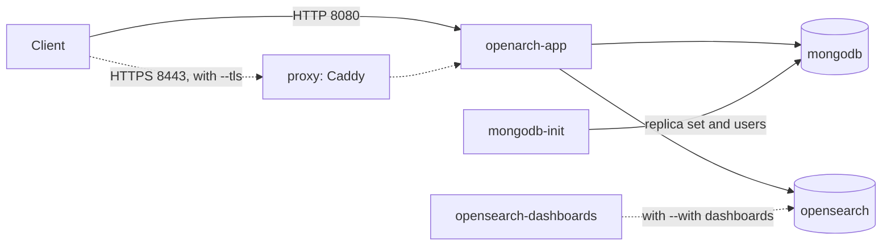

# openarch-cli

`openarch` is a command line tool to install and run [OpenArch](https://github.com/hyland/OpenArch) with Docker Compose.

It creates a workspace folder with plain files: `compose.yaml`, `.env`, `.env.local` and a few config files.
You can read them, and you can run `docker compose` on them without the CLI.

The same commands work for people and for scripts or AI agents:

- Every question in the interactive mode is also a flag.
- Every command supports `--output json`.
- Exit codes are stable.

## Status

Work in progress. These commands work today:

| Command | What it does |
| --- | --- |
| `openarch doctor` | Checks Docker, Docker Compose, memory, free ports and access to the image registry |
| `openarch init` | Creates a workspace with every deployment option |
| `openarch render` | Writes the workspace files again from `openarch.yaml` |
| `openarch up` | Starts the stack and waits until it is healthy |
| `openarch status` | Shows the state of each service and of the OpenArch API |
| `openarch logs` | Shows the logs of the services |
| `openarch down` | Stops the stack and keeps the data |
| `openarch api ping` | Checks that OpenArch answers and that the credentials work |
| `openarch version` | Prints the version |

Next: saved connections, admin commands, a smoke test, backups and upgrades.

## Requirements

- Docker with Docker Compose v2 or later
- About 4 GB of memory for Docker
- Go 1.26 or later, to build the CLI

On native Linux, OpenSearch needs `vm.max_map_count` set to at least 262144. `openarch doctor` checks this.

## Build

```
git clone https://github.com/AlfrescoLabs/openarch-cli.git
cd openarch-cli
make build
./bin/openarch version
```

Without `make`: `go build -o bin/openarch ./cmd/openarch`.

## Quick start

```
openarch doctor
openarch init --dir my-openarch
openarch up --dir my-openarch
```

`up` returns when OpenArch is healthy. OpenArch is then at http://localhost:8080, and the Swagger UI
is at http://localhost:8080/swagger-ui/index.html. The first start pulls about 2 GB of images, so it
takes a few minutes.

The admin user is `admin`. Its password is in `my-openarch/.env.local`, as `OPENARCH_ADMIN_PASSWORD`.

## Create a workspace

Run `openarch init` in a terminal, and it asks for each option that you did not give as a flag.
At the end it prints the same command with flags, so you can repeat it or use it in a script.

With `--non-interactive`, or when there is no terminal, `init` never asks. It uses the defaults for
missing values.

| Option | Flag | Values | Default |
| --- | --- | --- | --- |
| OpenArch version | `--version` | image tag of `ghcr.io/hyland/openarch-app-jvm` | latest tested tag |
| Storage | `--storage` | `volume` (Docker named volumes), `bind` (folders on the host), `none` (data is lost when the containers are removed) | `volume` |
| Data folder | `--data-dir` | path, with `--storage bind` | `./data` |
| HTTPS | `--tls` | `none`, `self-signed` (the CLI creates a certificate), `custom` (your own files) | `none` |
| Certificate files | `--cert`, `--key` | PEM files, with `--tls custom` | - |
| Server name | `--server-name` | host name for URLs and the certificate | `localhost` |
| Port | `--port` | host port | 8080, or 8443 with TLS |
| Listen address | `--bind-ip` | `127.0.0.1` (this machine only) or `0.0.0.0` (all interfaces) | `127.0.0.1` |
| Extra ports | `--expose` | `mongodb` (27017), `opensearch` (9200), `debug` (Java debugger, 5005), repeatable | none |
| Extra services | `--with` | `dashboards` (OpenSearch Dashboards on port 5601), repeatable | none |
| Memory | `--memory` | `auto` (from `docker info`) or a size such as `8g` | `auto` |
| Backend security | `--insecure-backends` | turns off authentication in MongoDB and OpenSearch | secured |
| OpenArch users | `--default-users` | keeps the users bundled in the OpenArch image | only `admin` |
| Admin password | `--admin-password-stdin` | read from stdin | generated |

Other flags:

- `--dry-run` lists the files that `init` would write, and writes nothing.
- `--force` overwrites an existing workspace. It keeps the passwords in `.env.local`.
- `--from <file>` creates a workspace from an existing `openarch.yaml`.

Examples:

```
# Data in folders on the host
openarch init --dir my-openarch --storage bind --data-dir /srv/openarch

# HTTPS with a self-signed certificate, on https://openarch.local:8443
openarch init --dir my-openarch --tls self-signed --server-name openarch.local

# HTTPS with your own certificate, open to the network
openarch init --dir my-openarch --tls custom --cert server.pem --key server-key.pem \
  --server-name openarch.example.com --port 443 --bind-ip 0.0.0.0

# A machine for development: debugger, OpenSearch Dashboards, more memory
openarch init --dir my-openarch --expose debug --with dashboards --memory 8g

# Your own admin password
printf '%s' "$PASSWORD" | openarch init --dir my-openarch --admin-password-stdin --non-interactive

# Every security feature off: plain HTTP, no passwords for MongoDB and OpenSearch,
# and the bundled OpenArch users (admin:password)
openarch init --dir my-openarch --insecure-backends --default-users
```

Risky choices print a warning on stderr, for example `--bind-ip 0.0.0.0` without TLS.

## Change a workspace

`openarch.yaml` is the source of truth. To change the deployment:

1. Edit `openarch.yaml`.
2. Run `openarch render --dry-run` to see the diff.
3. Run `openarch render` to write the files.
4. Run `openarch up`. It recreates only the services whose files or passwords changed.

`render` only touches files that change. When an option no longer needs a file (for example, the proxy
config after you turn off TLS), `render` deletes it.

## Run OpenArch

Run these in the workspace folder, or add `--dir my-openarch`:

```
openarch up                       # start, and wait until healthy
openarch status                   # state of each service and of the API
openarch logs openarch-app -f     # follow the OpenArch logs
openarch down                     # stop, and keep the data
```

- `up` runs the `doctor` checks first. Ports that this workspace already uses are not reported as busy.
  Use `--skip-doctor` to skip the checks.
- `up` waits up to 10 minutes. Change it with `--timeout`, or use `--wait=false` to return at once.
- `status` exits with code 0 when the stack is healthy, and 4 in any other state
  (`starting`, `unhealthy`, `stopped`).
- `down` keeps the named volumes and data folders. With `--storage none` there is no data to keep, so
  its volumes are removed.

### Without the CLI

The workspace is a plain Docker Compose project. In secure mode (the default), Docker Compose needs
both env files:

```
cd my-openarch
docker compose --env-file .env --env-file .env.local up -d
docker compose ps
docker compose logs -f openarch-app
docker compose down
```

With `--insecure-backends`, there are no secrets, and `docker compose up -d` is enough.

After a change to a password or to a file in `config/`, add `--force-recreate` to `up`. `openarch up`
does this for you, and only for the services that need it.

## Connect to the OpenArch API

Commands that call the API, such as `openarch api ping`, find the URL, user and password in this order:

1. Flags: `--url`, `--user`, `--password-stdin`. `--password` works too, but it prints a warning,
   because the password stays in the shell history.
2. Environment variables: `OPENARCH_URL`, `OPENARCH_USER`, `OPENARCH_PASSWORD`.
3. The workspace: the URL from `openarch.yaml` and the admin user and password from `.env.local`.
4. A hidden prompt, when the command runs in a terminal.

The first source that has a value wins, for each value. Workspace credentials are used only with the
workspace URL, so they are never sent to another server.

```
openarch api ping                                  # inside a workspace: no flags needed
openarch api ping --dir my-openarch --output json
printf '%s' "$PASSWORD" | openarch api ping --url https://openarch.example.com --user admin --password-stdin
```

- With a self-signed workspace certificate, the CLI trusts the workspace certificate. It also connects
  to the published port on this machine, so the server name does not need to resolve.
- `--insecure` (or `OPENARCH_INSECURE=true`) turns off certificate checks, with a warning each time.
- `--verbose` logs each request, with the `Authorization` header replaced by `REDACTED`.
- Exit code 6 means the credentials are missing or wrong. Exit code 5 means the server cannot be reached
  or returned an error.

## Workspace files

| File | Content |
| --- | --- |
| `openarch.yaml` | All options. Edit this file, then run `openarch render`. |
| `compose.yaml` | The services. Generated. |
| `.env` | Versions, ports and memory settings. No secrets. Generated. |
| `.env.local` | All passwords. Mode 0600, git-ignored. |
| `config/users.yml` | OpenArch users, with bcrypt hashes only. |
| `config/opensearch/` | OpenSearch security config, with bcrypt hashes only. |
| `config/Caddyfile`, `certs/` | HTTPS proxy config and the self-signed certificate. |
| `README.md` | Endpoints, users and commands of this workspace. |

## Services



- `openarch-app`: the OpenArch API. With TLS, it is not published on the host. Only the proxy is.
- `mongodb`: a one-node replica set, which OpenArch needs.
- `mongodb-init`: a one-shot service. It starts the replica set and creates the OpenArch database user.
- `opensearch`: the search index.
- `proxy`: only with `--tls`.
- `opensearch-dashboards`: only with `--with dashboards`.
- `data-init`: only with `--storage bind`. It sets the owners of the data folders.

By default, only the OpenArch port (or the proxy port) is published. MongoDB and OpenSearch stay on the
internal Docker network unless you use `--expose`.

## Security

Security is on by default. Every part can be turned off.

| Part | Default | To turn it off |
| --- | --- | --- |
| OpenArch users | Only `admin`, with a generated password. The users bundled in the image are not loaded. | `--default-users` |
| MongoDB | Authentication on. Users `root` and `openarch` (read and write on its own database only). | `--insecure-backends` |
| OpenSearch | Security plugin on. Users `admin`, `openarch` (cannot change security settings) and `kibanaserver`. | `--insecure-backends` |
| OpenSearch Dashboards | Login required. | `--insecure-backends` |
| HTTPS | Off. | Turn it on with `--tls self-signed` or `--tls custom`. |

How passwords are handled:

- The CLI generates every password and stores it only in `.env.local`.
- Docker Compose reads `.env.local` and gives each password to its container as a file in
  `/run/secrets`. Passwords are not in `compose.yaml`, not in container environment variables, and not
  in `docker inspect`.
- Config files hold only bcrypt hashes.
- The CLI never prints a password.

Notes:

- OpenArch always needs a user and password for its API. Only the health check, the Swagger UI and the
  API docs are public.
- Inside the Docker network, OpenSearch uses plain HTTP, with users and passwords required.
- The MongoDB root password and the OpenSearch passwords apply only when the data is created, at the
  first start. To change the OpenArch admin password or the MongoDB `openarch` password, edit
  `.env.local`, then run `openarch render` and `openarch up`.

## Output and exit codes

Use `--output json` (or `OPENARCH_OUTPUT=json`) to get one JSON document on stdout. Errors are JSON
too in this mode. Logs and warnings always go to stderr.

| Code | Meaning |
| --- | --- |
| 0 | OK |
| 1 | Error |
| 2 | Bad usage or input |
| 3 | A prerequisite is missing (for example, `doctor` found a problem) |
| 4 | A service is not healthy |
| 5 | Remote API error |
| 6 | Authentication failed |

## Development

```
go test ./...
go test ./internal/templates -update     # rewrite the golden files after a template change
make generate                            # regenerate the API client from api/openapi.json
go run github.com/golangci/golangci-lint/v2/cmd/golangci-lint@latest run ./...
```

- End-to-end tests are `testscript` files in `testdata/script/`.
- The templates have golden files in `internal/templates/testdata/`.
- When Docker is installed, the tests also check each golden case with `docker compose config`.
- The API client in `internal/api/gen` is generated with `oapi-codegen` from `api/openapi.json`, the
  spec of a running OpenArch (`/v3/api-docs`). CI fails when the generated code is not up to date.

## License

Apache License 2.0. See [LICENSE](LICENSE).
