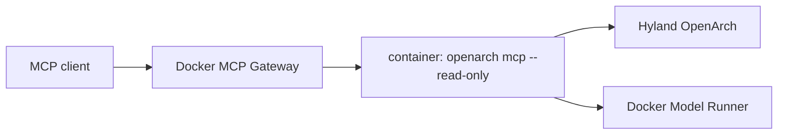

# Hyland OpenArch in the Docker MCP Gateway

Each release of the CLI for OpenArch has an image, `ghcr.io/alfrescolabs/openarch`, for
linux/amd64 and linux/arm64. It runs `openarch mcp --read-only` on stdin and stdout: an MCP server
with the tools that read (query, documents_get, documents_list and more), and no tools that write.
The server logs in as one user, so an agent sees only the documents that this user may read.

The [Docker MCP Gateway](https://github.com/docker/mcp-gateway) (the MCP Toolkit of Docker Desktop)
runs the image in a container for each client and keeps the password in the Docker Desktop secret
store. [openarch.yaml](openarch.yaml) is the server entry for the gateway.

The CLI for OpenArch is an AlfrescoLabs project. It is not an official Hyland product, and Hyland
does not officially support it.



## Requirements

- Docker Desktop with the MCP Toolkit and Docker Model Runner enabled
- `openarch` on your `PATH`, or `OPENARCH=/path/to/openarch`, to make the demo workspace
- `jq`, to read the demo passwords
- The embedding model for semantic search: `docker model pull ai/mxbai-embed-large`

## Run

```
./run.sh
PORT=<free port> IMAGE=<image> ./run.sh
```

`run.sh` makes a new demo workspace in a temp folder. It adds a server entry, a profile and a
secret to the gateway, with names that end in its process id. Then, as alice and as bob, it runs
the semantic query "salary levels" through the gateway with `docker mcp tools call`. It prints the
hits of each user, then `PASS` or `FAIL` from its own check, and always deletes the stack, the
entry, the profile and the secret at the end. It passes when alice (group demo-hr) finds "Salary
bands 2026" and bob (group demo-finance) does not.

## Set it up by hand

1. Start Hyland OpenArch with the CLI, for example `openarch init`, `openarch up`, then
   `openarch demo users` and `openarch demo load --embeddings`. `openarch credentials` shows the
   demo passwords.

2. Copy the server entry where the gateway reads local files, and make a profile with it:

   ```
   mkdir -p ~/.docker/mcp/catalogs
   cp openarch.yaml ~/.docker/mcp/catalogs/
   docker mcp profile create --name openarch --server file://$HOME/.docker/mcp/catalogs/openarch.yaml
   ```

3. Set the address and the user. Inside a container, the Docker host is `host.docker.internal`:

   ```
   docker mcp profile config openarch --set openarch.url=http://host.docker.internal:8080 --set openarch.user=alice
   ```

4. Store the password of the user as a secret. `printf '%s'` sends no newline, which would become
   part of the password. `secret set` does not replace an old value, so remove it first:

   ```
   docker mcp secret rm openarch.password
   printf '%s' 'the password of alice' | docker mcp secret set openarch.password
   ```

5. Call a tool through the gateway:

   ```
   docker mcp tools call --gateway-arg=--profile=openarch config_whoami
   docker mcp tools call --gateway-arg=--profile=openarch query "query=SELECT * FROM SysContent" "semantic=salary levels"
   ```

6. Connect your MCP client to the profile with `docker mcp client connect <client> --profile openarch`,
   or give the client the command `docker mcp gateway run --profile openarch`.

The gateway keeps one set of secrets for all profiles. For two users at the same time, make two
server entries with different names (for example `openarch-alice` and `openarch-bob`), each with
its own `<name>.url`, `<name>.user` and `<name>.password`. `run.sh` does the same with its own
name.

## The image without the gateway

```
docker run --rm -i \
  -e OPENARCH_URL=http://host.docker.internal:8080 \
  -e OPENARCH_USER=alice \
  -e OPENARCH_PASSWORD \
  ghcr.io/alfrescolabs/openarch
```

The image sets these variables:

- `OPENARCH_MODEL_URL=http://model-runner.docker.internal/engines/v1`, the address of Docker Model
  Runner inside a container, for semantic search;
- `OPENARCH_CONFIG_DIR=/tmp/openarch` and `OPENARCH_CREDENTIAL_STORE=file`: the container has no
  saved contexts and no OS credential store.

The default command is `mcp --read-only`. Any other command of the CLI replaces it, for example
`docker run --rm ghcr.io/alfrescolabs/openarch version`. Tools that need Docker or a workspace
(doctor, status, logs) do not work in the container.

## Check the image

The release workflow signs each image with cosign, without a key, from its GitHub Actions identity:

```
cosign verify ghcr.io/alfrescolabs/openarch:<version> \
  --certificate-oidc-issuer https://token.actions.githubusercontent.com \
  --certificate-identity-regexp '^https://github.com/AlfrescoLabs/openarch-cli/.github/workflows/release.yml@refs/tags/v'
```

`docker buildx imagetools inspect ghcr.io/alfrescolabs/openarch:<version>` shows the digest. Pin
the digest in `openarch.yaml` (`image: ghcr.io/alfrescolabs/openarch@sha256:...`) to run exactly the
image you checked.
