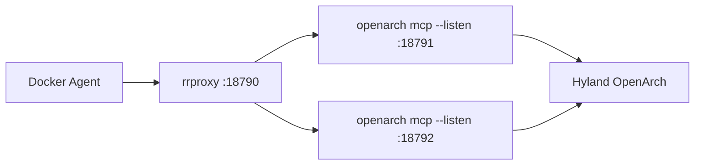

# One agent, a stateless MCP server, two copies behind a round-robin proxy

`openarch mcp --listen` serves MCP over Streamable HTTP. The server is stateless (MCP 2026-07-28):
there is no session and no handshake, and every request carries its own protocol version and client
capabilities. So any copy of the server can answer any request, with no sticky sessions.

This example proves it with [Docker Agent](https://github.com/docker/docker-agent) and a local model
on Docker Model Runner. For each user, two copies of the server run behind a small round-robin
proxy, [rrproxy](rrproxy/), which sends each request to the next copy and writes one JSON line per
request. The server logs in as one user, so each user still gets only the documents they may read.



The documents are the permission demo of the CLI plus the three plans of [../load](../load/). alice
(group demo-hr) may read "Pay scale 2027", bob (group demo-finance) may not.

## Requirements

- Docker Desktop with Docker Model Runner enabled, with host TCP access (`docker desktop enable model-runner --tcp 12434`)
- [Docker Agent](https://github.com/docker/docker-agent), with MCP 2026-07-28 support (tested with v1.157.2)
- `openarch` on your `PATH`, or `OPENARCH=/path/to/openarch`
- Go, to build the proxy (`go build`)
- The models: `docker model pull glm-4.7-flash:31B` and `docker model pull ai/mxbai-embed-large`

The chat model needs about 17 GB of memory. Stop other Docker stacks before you run it.

## Run

```
./run.sh
PORT=<free port> MODEL=<model> ./run.sh
```

`run.sh` makes a new demo workspace in a temp folder and loads the documents. Then, for alice and
for bob, it starts two copies of `openarch mcp --read-only --listen` and the proxy, and asks the
agent "How much is level 3 paid?". It prints the answer and the wire log of each user, then `PASS`
or `FAIL` from its own check, and always deletes the stack at the end. It passes only when:

- alice gets the pay of level 3, and bob does not get the pay scale;
- each agent made at least one tool call;
- every request used MCP 2026-07-28, and no request or reply has a session id;
- both copies of the server got requests.

The proxy listens on 127.0.0.1:18790, the URL in [agent.yaml](agent.yaml). The copies listen on
18791 and 18792.

## The wire log

One line per request, from `rrproxy`:

```json
{"time":"13:16:00","upstream":"127.0.0.1:18791","httpMethod":"POST","status":200,"mcpMethod":"server/discover","protocolVersion":"2026-07-28"}
{"time":"13:16:00","upstream":"127.0.0.1:18792","httpMethod":"POST","status":200,"mcpMethod":"subscriptions/listen","protocolVersion":"2026-07-28"}
{"time":"13:16:00","upstream":"127.0.0.1:18791","httpMethod":"POST","status":200,"mcpMethod":"tools/list","protocolVersion":"2026-07-28"}
{"time":"13:16:09","upstream":"127.0.0.1:18792","httpMethod":"POST","status":200,"mcpMethod":"tools/call","mcpName":"query","protocolVersion":"2026-07-28"}
{"time":"13:16:14","upstream":"127.0.0.1:18791","httpMethod":"POST","status":200,"mcpMethod":"tools/call","mcpName":"documents_get","protocolVersion":"2026-07-28"}
```

`subscriptions/listen` is the stream for notifications. It stays open, so a proxy in front of the
server must stream responses and not wait for their end.

## Step by step

```
openarch init --dir oa-mcp --context-name mcp --non-interactive
openarch demo users --dir oa-mcp
openarch up --dir oa-mcp
openarch demo load --dir oa-mcp --embeddings
openarch load ../load/plans/ --dir oa-mcp
export OPENARCH_MCP_TOKEN=$(openarch mcp token)
openarch mcp --context mcp-alice --read-only --listen 18791 &
openarch mcp --context mcp-alice --read-only --listen 18792 &
(cd rrproxy && go build -o ../rrproxy-bin .)
./rrproxy-bin -listen 127.0.0.1:18790 http://127.0.0.1:18791 http://127.0.0.1:18792 &
docker agent run agent.yaml --exec "How much is level 3 paid?"
```

Make the token before you start a server: two servers that make the first token at the same moment
can fail. Every server of the same user of the CLI uses the same token.

## Agent file

[agent.yaml](agent.yaml) has one toolset, a remote MCP server:

```yaml
toolsets:
  - type: mcp
    remote:
      url: http://127.0.0.1:18790/mcp
      transport_type: streamable
      headers:
        Authorization: "Bearer ${env.OPENARCH_MCP_TOKEN}"
    allow_private_ips: true
    tools: ["query", "documents_get", "documents_list", "config_whoami"]
```

- Docker Agent refuses a server on a private address such as 127.0.0.1 without `allow_private_ips`.
- `${env.X}` works in the header values, not in the URL.
- When a toolset fails to start, Docker Agent still runs, with no tools. A model with no tools can
  invent an answer. Check the answers, as `run.sh` does.

## Limits

- Tested with one client, Docker Agent, on macOS.
- The server logs in as one user of Hyland OpenArch, and the token belongs to the user who runs the
  CLI, not to each caller. Start one server per user.
- A stateless server sends no requests of its own to the client. Progress of a tool call still goes
  on the response stream of that call.
- `rrproxy` is a test tool for this example, not a load balancer.
